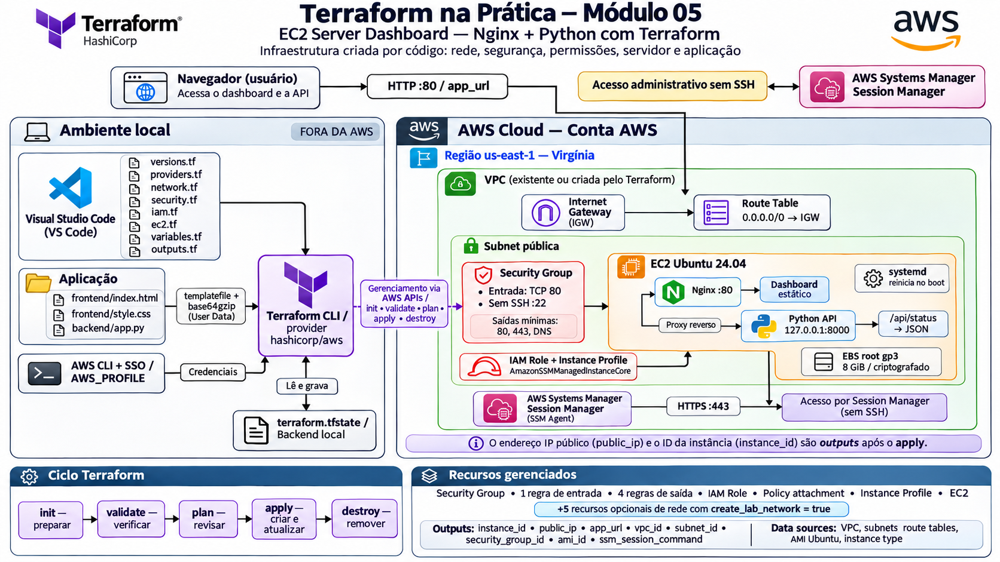

# Arquitetura - Módulo 05 (EC2 Server Dashboard)

Este documento explica **cada serviço AWS** do módulo e **como o código HCL vira recurso**. Todos os trechos são do código real em [`terraform/`](terraform/).

Cada serviço segue o mesmo roteiro: finalidade, recurso Terraform, código, argumentos, dependências, segurança, papel no fluxo, verificação e como alterar ou remover.

## Visão geral


*Figura: visão completa da solução, do ambiente local à AWS, com o ciclo do Terraform e os recursos gerenciados.*

```
                                     Internet
                                        │ HTTP 80
                      ┌─────────────────▼─────────────────┐
                      │ VPC (existente OU criada)         │
                      │  Internet Gateway ◄─ Route Table  │
                      │       (0.0.0.0/0)        │        │
                      │              Subnet pública       │
                      │   ┌──────────────────────────┐    │
                      │   │ EC2 + Security Group     │    │
                      │   │ Nginx:80 → Python:8000   │    │
                      │   └──────────────────────────┘    │
                      └───────────────────────────────────┘
          IAM Role + Instance Profile ──> SSM Agent ──> Session Manager (HTTPS 443 de saída)
```

Grafo de dependências, na ordem em que o Terraform cria:

```
(VPC → IGW → Subnet → Route Table → Associação)   [só com create_lab_network = true]
        │
        ▼
 Security Group ─► regras de entrada/saída
 IAM Role ─► Attachment ─► Instance Profile
        └────────────┬─────────────┘
                     ▼
               aws_instance.app  (AMI vem do data source)
```

O Terraform deduz esta ordem **sozinho** pelas referências (`aws_security_group.app.id`, `aws_iam_instance_profile.ec2[0].name`...). Ninguém escreveu a sequência.

---

## 1. Amazon VPC e rede

### 1.1 Finalidade

A VPC é a rede privada virtual onde a EC2 vive. A **subnet** define a AZ e a faixa de IPs. O **Internet Gateway (IGW)** dá acesso à internet, e a **Route Table** diz qual tráfego usa o IGW. Uma subnet só é **pública** se a route table efetiva dela tiver a rota `0.0.0.0/0` para um IGW. O nome da subnet não prova nada.

### 1.2 Recurso ou data source

| Caminho | Blocos |
|---|---|
| **A) Rede existente** (padrão) | `data aws_vpcs`, `aws_vpc`, `aws_subnets`, `aws_subnet`, `aws_route_tables`, `aws_route_table`, `aws_internet_gateway`, `aws_ec2_instance_type_offerings` |
| **B) Rede do laboratório** (`create_lab_network = true`) | `resource aws_vpc`, `aws_internet_gateway`, `aws_subnet`, `aws_route_table`, `aws_route_table_association` |

A escolha é feita por `count`: cada bloco de um caminho recebe `count = 0` quando o outro está ativo.

### 1.3 Código (caminho A, trechos de `network.tf`)

```hcl
data "aws_route_tables" "vpc" {
  count = local.use_existing_network ? 1 : 0

  filter {
    name   = "vpc-id"
    values = [local.existing_vpc_id]
  }
}

data "aws_route_table" "each" {
  for_each       = local.use_existing_network ? toset(data.aws_route_tables.vpc[0].ids) : toset([])
  route_table_id = each.value
}
```

O módulo resume cada route table e decide, com `locals`, se cada subnet é pública:

```hcl
route_table_summary = {
  for rt_id, rt in data.aws_route_table.each : rt_id => {
    default_route_to_igw = anytrue([
      for r in rt.routes : r.cidr_block == "0.0.0.0/0" && try(startswith(r.gateway_id, "igw-"), false)
    ])
    subnet_ids = compact([for a in rt.associations : try(a.subnet_id, "")])
    is_main    = anytrue([for a in rt.associations : a.main])
  }
}

# Regra da AWS: subnet sem associação explícita usa a route table principal.
subnet_is_public = {
  for sid, _ in data.aws_subnet.each : sid => (
    anytrue([for rt in local.route_table_summary : contains(rt.subnet_ids, sid) && rt.default_route_to_igw])
    || (!anytrue([for rt in local.route_table_summary : contains(rt.subnet_ids, sid)]) && local.main_route_table_is_public)
  )
}
```

Caminho B (rede criada pelo Terraform):

```hcl
resource "aws_vpc" "lab" {
  count                = var.create_lab_network ? 1 : 0
  cidr_block           = var.lab_vpc_cidr
  enable_dns_support   = true
  enable_dns_hostnames = true
}

resource "aws_route_table" "lab" {
  count  = var.create_lab_network ? 1 : 0
  vpc_id = aws_vpc.lab[0].id
  route {
    cidr_block = "0.0.0.0/0"
    gateway_id = aws_internet_gateway.lab[0].id
  }
}
```

Os dois caminhos desembocam em `local.vpc_id` e `local.subnet_id`. O resto do módulo usa só esses dois valores.

### 1.4 Argumentos principais

| Argumento | Tipo de valor | Efeito na AWS |
|---|---|---|
| `count = ... ? 1 : 0` | Expressão condicional | Liga (1) ou desliga (0) o recurso |
| `filter { name = "vpc-id" }` | Valor fixo + referência | Filtro enviado à API `Describe*` do EC2 |
| `cidr_block` | Variável (`var.lab_vpc_cidr`) | Faixa de IPs da VPC |
| `enable_dns_hostnames` | Valor fixo | Nomes DNS para instâncias da VPC |
| `map_public_ip_on_launch` | Valor fixo | Instâncias da subnet recebem IP público por padrão |
| `availability_zone` | Expressão sobre data source | Escolhe uma AZ que oferece o tipo de instância |
| `gateway_id` (na rota) | Referência | IGW que recebe o tráfego de saída |

### 1.5 Referências e dependências

- `aws_internet_gateway.lab[0].vpc_id = aws_vpc.lab[0].id`: o IGW só pode ser criado depois da VPC.
- `aws_route_table.lab[0]` referencia a VPC e o IGW.
- `aws_route_table_association.lab[0]` liga subnet e route table.
- O Security Group usa `local.vpc_id`. Por isso ele também espera a VPC quando ela é criada.

### 1.6 Segurança

- Sem NAT Gateway, sem VPN, sem peering. Só o necessário.
- O módulo **não altera** a VPC existente: no caminho A só há leitura.
- `precondition` na instância bloqueia o `plan` se a subnet não for pública:

```hcl
precondition {
  condition     = local.subnet_pub
  error_message = "A subnet escolhida não é pública: sua route table efetiva não tem rota 0.0.0.0/0 para um Internet Gateway."
}
```

- O data source `aws_internet_gateway.attached` exige que o IGW citado nas rotas esteja **anexado** à VPC. Uma rota para IGW desanexado não vale.

### 1.7 Papel no fluxo

O tráfego do navegador chega ao IGW, é encaminhado à subnet pelo roteamento da VPC e atravessa o Security Group até a EC2. A resposta e as saídas (apt, SSM) fazem o caminho inverso pelo IGW.

### 1.8 Como verificar

```powershell
# Terraform
terraform output network_diagnosis
terraform state list | Select-String "vpc|subnet|route|gateway"

# AWS CLI
aws ec2 describe-vpcs --vpc-ids <vpc-id>
aws ec2 describe-route-tables --filters Name=vpc-id,Values=<vpc-id>
aws ec2 describe-internet-gateways --filters Name=attachment.vpc-id,Values=<vpc-id>
```

Procure em `Routes` a linha com `DestinationCidrBlock = 0.0.0.0/0` e `GatewayId = igw-...`.


*Figura: a VPC do laboratório no console da AWS, com subnet e route table criadas pelo Terraform.*

### 1.9 Como alterar ou remover

- Trocar de VPC/subnet: altere `vpc_id`/`subnet_id` no `terraform.tfvars`. O `plan` mostrará `-/+` na instância (subnet nova) e nenhuma mudança na VPC antiga.
- Mudar `lab_vpc_cidr` com a rede criada: a VPC é **substituída** (`# forces replacement`), junto com tudo que depende dela.
- Remover: `terraform destroy` apaga a rede criada (caminho B). Em um caminho A nada é apagado, porque nada foi criado.

---

## 2. Security Group

### 2.1 Finalidade

Firewall com estado da interface de rede da EC2. Permite HTTP de entrada e as saídas mínimas.

### 2.2 Recurso

`aws_security_group` + `aws_vpc_security_group_ingress_rule` + `aws_vpc_security_group_egress_rule` (recursos atuais do provider, um por regra, no lugar dos blocos inline `ingress`/`egress`).

### 2.3 Código (`security.tf`)

```hcl
resource "aws_security_group" "app" {
  name_prefix = "${local.name}-sg-"
  description = "Dashboard EC2: HTTP de entrada, sem SSH"
  vpc_id      = local.vpc_id

  lifecycle {
    create_before_destroy = true
  }
}

resource "aws_vpc_security_group_ingress_rule" "http" {
  security_group_id = aws_security_group.app.id
  ip_protocol       = "tcp"
  from_port         = 80
  to_port           = 80
  cidr_ipv4         = var.allowed_http_cidr
}

resource "aws_vpc_security_group_egress_rule" "https" {
  security_group_id = aws_security_group.app.id
  ip_protocol       = "tcp"
  from_port         = 443
  to_port           = 443
  cidr_ipv4         = "0.0.0.0/0"
}
```

### 2.4 Argumentos principais

| Argumento | Tipo de valor | Efeito |
|---|---|---|
| `vpc_id` | Referência (`local.vpc_id`) | O grupo pertence a essa VPC e não muda de VPC |
| `name_prefix` | Valor montado | AWS completa com sufixo único (`...-sg-2024...`) |
| `security_group_id` | Referência (`.id`, computado) | Regra pertence a este grupo |
| `ip_protocol`, `from_port`, `to_port` | Valores fixos | Protocolo e portas |
| `cidr_ipv4` | Variável / fixo | Origem (entrada) ou destino (saída) |

Regras de saída criadas: 80/tcp (apt usa HTTP), 443/tcp (apt/HTTPS e SSM), 53 udp/tcp para o CIDR da VPC (DNS).

### 2.5 Dependências

`aws_security_group.app` depende da VPC. As regras dependem do grupo. A instância referencia `aws_security_group.app.id` em `vpc_security_group_ids`.

### 2.6 Segurança

- **SSH (22) não é liberado.** Não existe regra para ele. O acesso administrativo é pelo Session Manager.
- `allowed_http_cidr` permite restringir a porta 80 ao seu IP (`x.x.x.x/32`).
- Saída restrita a portas necessárias em vez de "tudo liberado".
- `create_before_destroy` + `name_prefix`: se o grupo precisar ser substituído, o novo existe antes de o antigo sair, e a instância nunca fica sem grupo.

### 2.7 Papel no fluxo

Toda requisição que chega à porta 80 passa pelo grupo. Como ele é *stateful*, a resposta volta sem regra de saída adicional para a conexão já aberta.

### 2.8 Como verificar

```powershell
terraform output security_group_id
aws ec2 describe-security-group-rules --filters Name=group-id,Values=<sg-id>
terraform state show aws_vpc_security_group_ingress_rule.http
```

Confirme: uma regra de entrada (80) e nenhuma com `FromPort = 22`.


*Figura: o Security Group com a regra de entrada TCP 80 e nenhuma regra para a porta 22.*

### 2.9 Como alterar ou remover

- Mudar `allowed_http_cidr` altera apenas a regra de entrada; o grupo e a instância permanecem. Leia no plan se o símbolo é `~` (no lugar) ou `-/+` (regra recriada): o provider decide.
- Mudar `vpc_id` substitui o grupo e a instância.
- Remover: `terraform destroy`. A ordem é instância, regras, grupo.

---

## 3. Amazon EC2 e volume EBS

### 3.1 Finalidade

Executa o Nginx e o backend Python. É o único componente que gera custo contínuo relevante.

### 3.2 Recurso e data sources

- `data "aws_ami" "ubuntu"`: encontra a AMI por filtros (nunca por ID fixo).
- `data "aws_ec2_instance_type" "selected"`: lê as arquiteturas suportadas pelo tipo.
- `resource "aws_instance" "app"`: a instância. O volume root é definido em `root_block_device`.

### 3.3 Código (`ec2.tf`)

```hcl
data "aws_ami" "ubuntu" {
  most_recent = true
  owners      = ["099720109477"] # Canonical

  filter {
    name   = "name"
    values = ["ubuntu/images/hvm-ssd-gp3/ubuntu-noble-24.04-${local.ami_arch_suffix[var.architecture]}-server-*"]
  }
  filter {
    name   = "architecture"
    values = [var.architecture]
  }
}

resource "aws_instance" "app" {
  ami                         = data.aws_ami.ubuntu.id
  instance_type               = var.instance_type
  subnet_id                   = local.subnet_id
  vpc_security_group_ids      = [aws_security_group.app.id]
  associate_public_ip_address = true
  iam_instance_profile        = var.enable_ssm ? aws_iam_instance_profile.ec2[0].name : null

  user_data                   = local.user_data
  user_data_replace_on_change = true

  metadata_options {
    http_tokens                 = "required"
    http_put_response_hop_limit = 1
  }

  root_block_device {
    volume_type = "gp3"
    volume_size = var.root_volume_size
    encrypted   = true
  }

  tags = { Name = local.name }

  lifecycle {
    ignore_changes = [ami]
  }
}
```

### 3.4 Argumentos principais

| Argumento | Tipo de valor | Efeito |
|---|---|---|
| `owners = ["099720109477"]` | Fixo | Só AMIs da Canonical (evita imagens de terceiros com nome parecido) |
| `most_recent = true` | Fixo | Dentre as que casam com o filtro, a mais nova |
| `ami` | Referência (computado em leitura) | Imagem de disco usada no boot |
| `instance_type` | Variável | Tamanho (vCPU/RAM) |
| `subnet_id` | Referência (`local`) | AZ e rede da instância |
| `vpc_security_group_ids` | Lista de referências | Firewall |
| `associate_public_ip_address` | Fixo | IP público automático. **Não é Elastic IP** |
| `iam_instance_profile` | Referência condicional | Permissões para o SSM Agent |
| `user_data` | Expressão (`templatefile`) | Script do primeiro boot |
| `user_data_replace_on_change` | Fixo | Alterar o script **substitui** a instância |
| `metadata_options.http_tokens = "required"` | Fixo | IMDSv2 obrigatório (proteção contra SSRF) |
| `root_block_device.encrypted` | Fixo | Volume criptografado em repouso |
| `volume_size` | Variável (validada 8 a 30) | Tamanho do disco em GiB |
| `tags` | Fixo + `default_tags` | `Name` no recurso; `Project`, `Environment`, `ManagedBy` pelo provider |

Valores computados (só após o `apply`): `id`, `public_ip`, `private_ip`, `arn`.

### 3.5 Dependências e validações

A instância referencia grupo, perfil IAM, subnet e AMI. O Terraform cria esses antes dela. Quatro `precondition` protegem o `plan`:

1. O tipo suporta a arquitetura escolhida.
2. Existe uma subnet elegível.
3. A subnet é pública.
4. O User Data não passa de 16 KB.

### 3.6 Ciclo de vida e substituição

| Alteração | Resultado no plan |
|---|---|
| `instance_type` | `~ update in-place` (a AWS para e reinicia a instância; os serviços sobem de novo pelo systemd) |
| `tags`, `iam_instance_profile`, `vpc_security_group_ids` | `~ update in-place` |
| `user_data` (qualquer arquivo em `application/`) | `-/+ replace` (`user_data_replace_on_change`) |
| `subnet_id`, `root_block_device.encrypted` | `-/+ replace` (ver `# forces replacement` no plan) |
| Nova AMI publicada | Nada (`ignore_changes = [ami]`) |

Na substituição, a instância nova ganha **novo ID e novo IP público**. O `public_ip` também muda se a instância for parada e iniciada. Para ter IP estável seria preciso um Elastic IP, que este módulo não usa.

### 3.7 Segurança

IMDSv2 obrigatório, disco criptografado, sem chave SSH (`key_name` não é definido), sem SSH aberto, perfil IAM mínimo.

### 3.8 Papel no fluxo

Recebe HTTP na porta 80 (Nginx), consulta o backend local e devolve JSON/HTML. Ao subir, executa o User Data (seção 5).

### 3.9 Como verificar

```powershell
terraform state show aws_instance.app
aws ec2 describe-instances --instance-ids <id> --query "Reservations[].Instances[].[State.Name,PublicIpAddress,InstanceType,ImageId]"
aws ec2 describe-instances --instance-ids <id> --query "Reservations[].Instances[].MetadataOptions"
aws ec2 describe-volumes --filters Name=attachment.instance-id,Values=<id> --query "Volumes[].[VolumeType,Size,Encrypted]"
```

Esperado: `HttpTokens = required`, volume `gp3`, `Encrypted = true`.


*Figura: a instância EC2 em execução, criada pelo Terraform.*

### 3.10 Como alterar ou remover

Edite o `terraform.tfvars` ou o código, rode `terraform plan` e leia os símbolos antes do `apply`. Para remover: `terraform destroy`. O volume root é apagado junto (`delete_on_termination = true`).

---

## 4. IAM e Systems Manager (Session Manager)

### 4.1 Finalidade

Dar à EC2 permissão para falar com o Systems Manager. Assim você abre um terminal pelo navegador ou pela CLI **sem SSH**, sem chave e sem porta de entrada.

### 4.2 Recursos

`aws_iam_role`, `aws_iam_role_policy_attachment`, `aws_iam_instance_profile` e os data sources `aws_iam_policy_document` e `aws_partition`.

### 4.3 Código (`iam.tf`)

```hcl
data "aws_iam_policy_document" "ec2_trust" {
  statement {
    effect  = "Allow"
    actions = ["sts:AssumeRole"]
    principals {
      type        = "Service"
      identifiers = ["ec2.amazonaws.com"]
    }
  }
}

resource "aws_iam_role" "ec2" {
  count              = var.enable_ssm ? 1 : 0
  name               = "${local.name}-ec2-role-${var.aws_region}"
  assume_role_policy = data.aws_iam_policy_document.ec2_trust.json
}

resource "aws_iam_role_policy_attachment" "ssm_core" {
  count      = var.enable_ssm ? 1 : 0
  role       = aws_iam_role.ec2[0].name
  policy_arn = "arn:${data.aws_partition.current.partition}:iam::aws:policy/AmazonSSMManagedInstanceCore"
}

resource "aws_iam_instance_profile" "ec2" {
  count = var.enable_ssm ? 1 : 0
  name  = "${local.name}-ec2-profile-${var.aws_region}"
  role  = aws_iam_role.ec2[0].name
}
```

### 4.4 Argumentos principais

| Argumento | Tipo de valor | Efeito |
|---|---|---|
| `assume_role_policy` | Referência (`.json` do data source) | Política de **confiança**: só o serviço EC2 assume a role |
| `policy_arn` | Valor montado | Política gerenciada pela AWS com as permissões do SSM Agent |
| `role` (no profile) | Referência | Role contida no Instance Profile |
| `count` | Condicional | Tudo é opcional por `enable_ssm` |

O data source `aws_iam_policy_document` não chama a AWS: ele só gera o JSON, o que evita escrever JSON à mão.

### 4.5 Dependências

Role → attachment e profile. A instância referencia o **profile** (não a role). A EC2 só recebe credenciais temporárias da role por meio do profile.

### 4.6 Segurança

- Privilégio mínimo: somente `AmazonSSMManagedInstanceCore`.
- Nenhuma credencial fixa no disco. A role fornece credenciais temporárias via IMDSv2.
- Nomes incluem a região para não colidirem em implantações em outras regiões.

### 4.7 Conectividade do SSM

O SSM Agent (já instalado na AMI Ubuntu como snap) abre conexões **de saída** para os endpoints `ssm`, `ssmmessages` e `ec2messages` por HTTPS. Isso funciona porque:

1. A EC2 tem IP público e a subnet tem rota para o IGW.
2. O Security Group permite saída 443.
3. A role tem a política do SSM.

Não é necessário NAT Gateway nem VPC Endpoints para o laboratório.

### 4.8 Como verificar

```powershell
aws ssm describe-instance-information --filters Key=InstanceIds,Values=<instance-id>
# PingStatus = Online indica agente registrado (leva 1 a 3 min após o boot)

aws ssm start-session --target <instance-id> --region <regiao>
```

Dentro da sessão: `systemctl status snap.amazon-ssm-agent.amazon-ssm-agent.service`.

Para listar o que o Terraform criou: `terraform state list | Select-String iam`.


*Figura: a Role da EC2 com a política `AmazonSSMManagedInstanceCore`.*

### 4.9 Como alterar ou remover

- `enable_ssm = false` remove role, attachment e profile (e a instância perde `iam_instance_profile`, alteração no lugar).
- Para dar mais permissões, adicione outro `aws_iam_role_policy_attachment`.
- Mudar o `name` da role a **substitui**.

---

## 5. Aplicação: User Data, Python, Nginx e systemd

### 5.1 Finalidade

Transformar uma EC2 vazia em servidor de aplicação no primeiro boot, sem etapas manuais.

### 5.2 Mecanismo de entrega do código

O código fica em `application/` na sua máquina. O Terraform o embute no User Data:

```hcl
locals {
  app_files = {
    "/opt/dashboard/server.py"              = "backend/server.py"
    "/var/www/dashboard/index.html"         = "frontend/index.html"
    "/etc/systemd/system/dashboard.service" = "system/dashboard.service"
    "/etc/nginx/conf.d/dashboard.conf"      = "system/dashboard.nginx.conf"
    # ... style.css e app.js
  }

  user_data = replace(templatefile("${path.module}/templates/user_data.sh.tftpl", {
    files = {
      for dest, src in local.app_files :
      dest => base64gzip(replace(file("${path.module}/../application/${src}"), "\r\n", "\n"))
    }
  }), "\r\n", "\n")
}
```

No template, o laço `%{ for dest, content in files ~}` gera uma linha por arquivo:

```bash
echo '<conteúdo gzip+base64>' | base64 -d | gunzip > '/opt/dashboard/server.py'
```

A EC2 não busca nada fora dela. O limite do User Data é 16 KB; este módulo usa cerca de 8,7 KB, e uma `precondition` avisa se passar. O `replace(..., "\r\n", "\n")` evita que o Git no Windows quebre scripts Linux com finais de linha CRLF.

### 5.3 Sequência do bootstrap

1. `apt-get update` e `apt-get install -y nginx python3` (esperando o lock do apt).
2. Cria o usuário de sistema `dashboard`, sem login.
3. Grava os arquivos da aplicação.
4. Remove o site padrão do Nginx e valida com `nginx -t`.
5. `systemctl daemon-reload`, `systemctl enable --now dashboard.service`.
6. `systemctl enable nginx` e `systemctl restart nginx`.

Tudo é registrado em `/var/log/dashboard-bootstrap.log`.

### 5.4 Python, Nginx e systemd

| Peça | Arquivo | Configuração chave |
|---|---|---|
| Backend | `application/backend/server.py` | `ThreadingHTTPServer(("127.0.0.1", 8000), ...)`. Somente biblioteca padrão. Rotas `/api/status` e `/api/health` |
| Serviço | `application/system/dashboard.service` | `User=dashboard`, `Restart=always`, `WantedBy=multi-user.target`, `NoNewPrivileges`, `ProtectSystem=strict` |
| Proxy | `application/system/dashboard.nginx.conf` | `listen 80 default_server`; `location /` serve estáticos; `location /api/` faz `proxy_pass http://127.0.0.1:8000` |

O `/api/status` devolve JSON com hostname, SO, kernel, arquitetura, uptime, CPU, load average, memória, disco e metadados da instância lidos pelo IMDSv2 (ID, tipo, AZ, IPs, AMI).

### 5.5 Segurança

- O backend não aceita conexões externas: só o Nginx, no mesmo host, o alcança.
- Processo sem privilégios (`dashboard`) e com restrições do systemd.
- O JavaScript usa `textContent`, nunca `innerHTML`, para não interpretar HTML vindo da API.
- Nenhum segredo no User Data. Lembre que o User Data é legível por quem tiver `ec2:DescribeInstanceAttribute`.

### 5.6 Persistência após reinicialização

`systemctl enable` cria os vínculos de boot. Teste com `sudo reboot`: depois de alguns segundos a URL volta a responder. O User Data **não** roda de novo (executa só no primeiro boot), e isso não é necessário porque os arquivos e serviços já estão no disco.

### 5.7 Como verificar

```bash
# dentro da EC2 (Session Manager)
sudo cloud-init status --long
sudo tail -n 40 /var/log/dashboard-bootstrap.log
systemctl is-active dashboard nginx
systemctl is-enabled dashboard nginx
sudo ss -ltnp | grep -E ':(80|8000)\b'     # 8000 deve aparecer em 127.0.0.1
curl -s http://127.0.0.1:8000/api/status
curl -s http://127.0.0.1/api/status
```

### 5.8 Como alterar ou remover

Editar qualquer arquivo de `application/` muda `local.user_data`. O plan mostra `-/+ aws_instance.app` com `user_data` alterado. Para atualizar sem recriar a instância, seria preciso outro mecanismo (SSM Run Command ou pipeline), fora do escopo. Remover: o `destroy` encerra a instância e tudo que ela continha.

---

## 6. Como o código vira recursos: resumo do ciclo

| Etapa | O que acontece |
|---|---|
| `terraform init` | Baixa o provider AWS (versão travada em `.terraform.lock.hcl`) |
| `terraform plan` | Lê os data sources, avalia `locals`, compara com o state e lista as ações |
| `terraform apply` | Cria na ordem do grafo e grava IDs e atributos computados no state |
| `terraform state list` / `show` | Inspecionam o que foi gravado (`terraform.tfstate`) |
| `terraform destroy` | Percorre o grafo ao contrário e remove **somente o que está no state** |

Valores que só existem após o `apply`: `aws_instance.app.id`, `public_ip`, `aws_security_group.app.id`, ARNs, IDs de rede criada. No plan eles aparecem como `(known after apply)`.

Valores conhecidos antes do `apply`: variáveis, `locals` sem dependência de recursos e data sources lidos no plan (AMI, rotas, subnets).

## 7. Mapa de arquivos

| Arquivo | Conteúdo |
|---|---|
| `versions.tf` | Versões do Terraform e do provider |
| `providers.tf` | Região e `default_tags` |
| `variables.tf` | Entradas com validações |
| `network.tf` | Data sources de rede e rede opcional do laboratório |
| `security.tf` | Security Group e regras |
| `iam.tf` | Role, política e Instance Profile |
| `ec2.tf` | AMI, User Data e instância |
| `outputs.tf` | Saídas: instância, IP, URL, VPC, subnet, Security Group |
| `templates/user_data.sh.tftpl` | Script de bootstrap |
