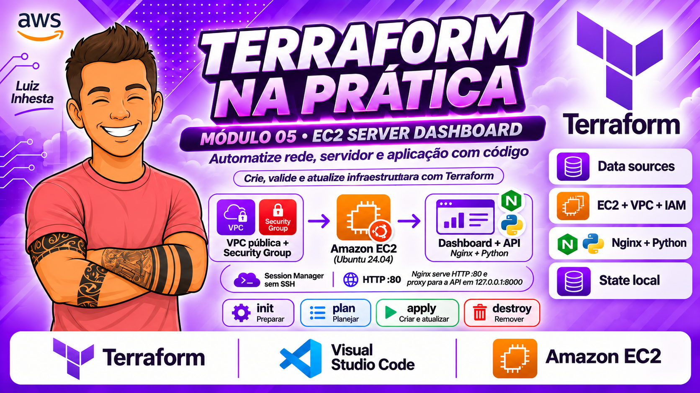
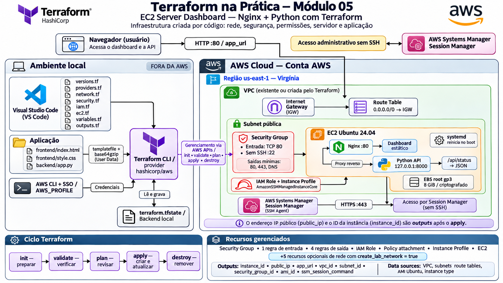

# Terraform na Prática: do `terraform init` a um servidor web na AWS

> Módulo 05 · EC2 Server Dashboard



Muita gente aprende Terraform criando um bucket S3 e para por aí. O problema é que infraestrutura real tem dependências: rede, firewall, permissões, servidor e a aplicação rodando dentro dele. Neste módulo, tudo isso nasce de código HCL. Nada é criado pelo console da AWS.

O resultado é simples de enxergar: uma instância EC2 com Ubuntu serve um painel de monitoramento em `http://<ip-público>` e uma API JSON em `http://<ip-público>/api/status`. O painel é só pretexto. O que importa é **como o Terraform monta, conecta e protege cada peça**.



## O que você vai aprender

- Descobrir recursos existentes com **data sources**, em vez de copiar IDs para o código.
- Criar recursos de forma **condicional** com `count`.
- Deixar o Terraform deduzir a **ordem de criação** pelas referências.
- Embutir uma aplicação no **User Data** com `templatefile` e `base64gzip`.
- Barrar configurações erradas **antes** do `apply`, com `precondition` e `validation`.
- Ler um `plan`, entender o **state** e reconhecer **drift**.

## A arquitetura em uma linha

```
Navegador ──HTTP:80──> Security Group ──> EC2 (Ubuntu 24.04)
                                           ├─ Nginx :80 (estáticos + proxy reverso)
                                           │     └─ /api/*  ──> 127.0.0.1:8000
                                           └─ Python (systemd) 127.0.0.1:8000 ──> JSON

Você ──Session Manager (HTTPS 443 de saída)──> shell na EC2, sem SSH
```

Decisões de segurança que aparecem no código:

- Só a porta 80 de entrada. **Não existe regra para a porta 22**.
- Acesso administrativo por **Session Manager**, com IAM Role mínima.
- Backend Python escutando só em `127.0.0.1`.
- Volume EBS criptografado e **IMDSv2 obrigatório** (`http_tokens = "required"`).
- Regras de saída limitadas ao necessário (80, 443 e DNS).

## Estrutura do projeto

```
.
├── application/        # Código que roda DENTRO da EC2
│   ├── backend/        #   API Python (biblioteca padrão)
│   ├── frontend/       #   HTML, CSS e JS do painel
│   └── system/         #   unit do systemd e conf do Nginx
└── terraform/
    ├── versions.tf     # versão do Terraform e do provider
    ├── providers.tf    # provider AWS + default_tags
    ├── variables.tf    # entradas e validações
    ├── network.tf      # rede existente (data) OU rede criada (resource)
    ├── security.tf     # Security Group e regras
    ├── iam.tf          # Role, policy e Instance Profile (SSM)
    ├── ec2.tf          # AMI, User Data e instância
    ├── outputs.tf      # IP, URL, diagnóstico de rede
    └── templates/
        └── user_data.sh.tftpl
```

Cada arquivo `.tf` tem uma responsabilidade. O Terraform lê todos juntos e monta o grafo de dependências sozinho.

## Passo 1: provider e versões

O `versions.tf` trava o Terraform (`>= 1.5.0, < 2.0.0`) e o provider AWS (`~> 6.0`). O `.terraform.lock.hcl` fixa a versão exata e **deve ir para o Git**, para que todos usem o mesmo provider.

No `providers.tf` não há credenciais. Elas vêm do perfil do AWS CLI (`AWS_PROFILE`). O bloco `default_tags` aplica `Project`, `Environment`, `Module` e `ManagedBy` a todos os recursos, e o state mostra isso em `tags_all`.

## Passo 2: variáveis com validação

Nenhum valor específico do ambiente fica no código. Tudo é variável, com `default` seguro e `validation`:

```hcl
variable "vpc_id" {
  type    = string
  default = null
  validation {
    condition     = var.vpc_id == null || can(regex("^vpc-[0-9a-f]+$", var.vpc_id))
    error_message = "vpc_id deve ter o formato vpc-xxxxxxxx."
  }
}
```

Quem usa o projeto copia `terraform.tfvars.example` para `terraform.tfvars` (este fica fora do Git) e ajusta. O erro de digitação aparece no `plan`, não depois de dez minutos de `apply`.

## Passo 3: rede por data sources ou por recursos

A variável `create_lab_network` escolhe entre dois caminhos:

| Valor | Comportamento |
|---|---|
| `false` (padrão) | **Lê** uma VPC existente com data sources. Nada de rede é criado. |
| `true` | **Cria** VPC, subnet, Internet Gateway e route table. Tudo some no `destroy`. |

Os dois caminhos terminam em dois `locals`: `local.vpc_id` e `local.subnet_id`. O resto do projeto só usa esses locals e não sabe de onde eles vieram. É um bom padrão para isolar decisões.

### Como o Terraform sabe se uma subnet é pública?

Pelo nome, não. Uma subnet é pública quando a route table **efetiva** dela tem uma rota `0.0.0.0/0` para um Internet Gateway. Se a subnet não tem associação explícita, vale a route table principal da VPC. O `network.tf` implementa essa regra com `for`, `anytrue`, `contains` e `try`, e a instância ainda tem um `precondition` que interrompe o `plan` se a conclusão for "não é pública".

## Passo 4: a AMI nunca é escrita no código

O ID de uma AMI muda a cada publicação. Em vez de fixá-lo, o `ec2.tf` pergunta à AWS:

```hcl
data "aws_ami" "ubuntu" {
  most_recent = true
  owners      = ["099720109477"] # Canonical
  filter {
    name   = "name"
    values = ["ubuntu/images/hvm-ssd-gp3/ubuntu-noble-24.04-amd64-server-*"]
  }
}
```

O `owners` é o ID público da Canonical e garante que só imagens oficiais sejam aceitas. Na instância, `ignore_changes = [ami]` evita que uma nova AMI publicada force a substituição do servidor no próximo `plan`.

## Passo 5: a aplicação viaja dentro do User Data

A EC2 não depende de arquivos da sua máquina. O Terraform lê os arquivos de `application/`, comprime e codifica cada um, e injeta tudo no script de inicialização:

```hcl
user_data = templatefile("${path.module}/templates/user_data.sh.tftpl", {
  files = {
    for dest, src in local.app_files :
    dest => base64gzip(file("${path.module}/../application/${src}"))
  }
})
```

No primeiro boot, o cloud-init instala Nginx e Python, grava os arquivos, registra o serviço no systemd e sobe tudo. Um `precondition` confere se o resultado cabe no limite de 16 KB do User Data.

Efeito colateral importante: com `user_data_replace_on_change = true`, **alterar qualquer arquivo da aplicação substitui a instância**. O `plan` mostra isso como `-/+` e `# forces replacement`.

## Passo 6: permissões sem chave SSH

O `iam.tf` monta a cadeia completa:

```
Role (política de confiança: ec2.amazonaws.com)
  └─ attachment da política AmazonSSMManagedInstanceCore
       └─ Instance Profile ──> EC2
```

A EC2 não recebe uma Role diretamente, e sim um Instance Profile que a contém. Tudo é opcional por `enable_ssm`. Com isso, o acesso ao terminal é feito por `aws ssm start-session`, sem porta 22 aberta e sem par de chaves.

## Passo 7: Security Group com regras separadas

As regras são recursos próprios (`aws_vpc_security_group_ingress_rule` e `aws_vpc_security_group_egress_rule`), que é a forma atual recomendada pelo provider. O grupo usa `name_prefix` com `create_before_destroy`, então uma substituição cria o novo antes de apagar o antigo.

## O ciclo de trabalho

```bash
cd terraform
cp terraform.tfvars.example terraform.tfvars   # ajuste para o seu ambiente
terraform init        # baixa o provider
terraform fmt         # padroniza o código
terraform validate    # confere sintaxe e referências
terraform plan        # mostra o que será feito, sem alterar nada
terraform apply       # cria a infraestrutura
terraform output app_url
terraform destroy     # remove tudo
```

Antes do `apply`, leia o `plan`: `+` cria, `~` altera no lugar, `-/+` substitui, `-` destrói. Valores que só existem depois da criação (`id`, `public_ip`, ARNs) aparecem como `(known after apply)`.

## Os quatro tipos de valor em HCL

```hcl
resource "aws_instance" "app" {
  instance_type = var.instance_type        # 1) variável
  ami           = data.aws_ami.ubuntu.id   # 2) referência a data source
  subnet_id     = local.subnet_id          # 2) referência a local
  root_block_device {
    volume_type = "gp3"                    # 3) valor fixo
  }
}
# 4) atributo computado: aws_instance.app.public_ip nasce na AWS
```

## Conceitos de Terraform por arquivo

| Conceito | Onde aparece |
|---|---|
| Data sources | `network.tf`, `ec2.tf` |
| Criação condicional (`count`) | `network.tf`, `iam.tf` |
| Referências e grafo de dependências | `security.tf`, `ec2.tf` |
| Atributos computados | `outputs.tf` |
| `templatefile` e `base64gzip` | `ec2.tf` |
| `precondition` e `validation` | `ec2.tf`, `variables.tf` |
| `lifecycle` | `security.tf`, `ec2.tf` |
| `for`, `anytrue`, `try`, `compact` | `network.tf` |
| `default_tags` | `providers.tf` |

## State, drift e substituição

O state local (`terraform.tfstate`) é o mapa entre o código e a AWS. Ele contém IDs, ARNs e IPs reais, por isso **nunca vai para o Git**. Para inspecionar:

```bash
terraform state list
terraform state show aws_instance.app
```

Se alguém alterar um recurso pelo console, o `plan` mostra a divergência (drift) e o `apply` a corrige. Dados lidos por `data` não entram no `destroy`: a VPC existente nunca é apagada.

## Para praticar

1. **Rede.** Abra `terraform console` e consulte `local.subnet_is_public`. Compare com o resultado de `aws ec2 describe-route-tables`.
2. **Alteração x substituição.** Mude `instance_type` e veja `~`. Depois altere uma linha de `application/frontend/index.html` e veja `-/+`.
3. **Precondition.** Use `instance_type = "t4g.micro"` com `architecture = "x86_64"` e leia o erro.
4. **Segurança.** Defina `allowed_http_cidr` com `<seu-ip>/32`, aplique e teste de outra rede.
5. **Drift.** Remova a regra de entrada pelo console, rode `terraform plan` e interprete a saída.

## Perguntas de revisão

1. Por que a subnet é classificada como pública pelas rotas e não pelo nome?
2. Qual a diferença entre os data sources `aws_vpcs` e `aws_vpc`?
3. Por que o backend escuta só em `127.0.0.1`?
4. O que acontece com o IP público se a instância for substituída?
5. Por que `ignore_changes = [ami]` evita substituições inesperadas?

## Pré-requisitos e custos

- Terraform 1.5 ou superior e AWS CLI v2 com credenciais configuradas.
- Permissões para EC2, VPC, IAM (roles e instance profiles) e leitura de SSM.
- Plugin do Session Manager para a AWS CLI (opcional, para abrir o terminal da EC2).
- A instância e o volume EBS são cobrados enquanto existirem, além do IPv4 público. **Destrua ao final.**

## Boas práticas para publicar um projeto Terraform

Este repositório segue uma regra: o código é público, o ambiente não.

- Nada de IDs, contas, domínios ou IPs no código. Use variáveis e data sources.
- `terraform.tfvars`, `*.tfstate` e `tfplan` ficam fora do Git (veja o `.gitignore`). Só o `.tfvars.example` é versionado.
- Os prints deste módulo mostram IDs reais, mas de um ambiente que já foi destruído (`terraform destroy`). Em um ambiente ativo, oculte IDs, IPs e a conta antes de publicar.
- Credenciais nunca ficam no `provider`. Use perfil do AWS CLI ou OIDC.

## Documentação complementar

| Documento | Conteúdo |
|---|---|
| [ARQUITETURA.md](ARQUITETURA.md) | Cada recurso em detalhe: código, argumentos, dependências e verificação |
| [IMPLANTACAO.md](IMPLANTACAO.md) | Passo a passo: rede, `init`, `plan`, `apply`, logs e testes |
| [DESTRUIR.md](DESTRUIR.md) | Como remover somente o que pertence ao laboratório |
